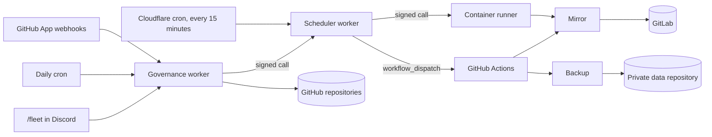

# fleet-ops

Automation for running a fleet of GitHub repositories: a scheduler that keeps jobs on UK time, governance that keeps every repository tidy, mirroring to GitLab and a backup of issues, pull requests and releases.

[](https://github.com/zaccesss/fleet-ops/actions/workflows/ci.yml)
[](https://github.com/zaccesss/fleet-ops/actions/workflows/markdownlint.yml)
[](https://github.com/zaccesss/fleet-ops/actions/workflows/codeql.yml)
[](https://github.com/zaccesss/fleet-ops/actions/workflows/gitleaks.yml)
[](https://scorecard.dev/viewer/?uri=github.com/zaccesss/fleet-ops)
[](https://github.com/zaccesss/fleet-ops/releases/latest)
[](LICENSE)

## The four systems

| System | Folder | What it does |
| --- | --- | --- |
| Scheduler | [`workers/scheduler`](workers/scheduler) | Starts every job at its real UK time, across clock changes and missed ticks |
| Governance | [`workers/governance`](workers/governance) | Deletes merged branches, merges safe Dependabot updates, syncs labels, prunes stale branches and reports settings drift |
| Mirror | [`python/mirror`](python/mirror) | Copies every repository to GitLab, keeping private ones private |
| Backup | [`python/backup`](python/backup) | Saves issues, pull requests, comments, reviews and releases as JSON |

Two shared packages sit underneath: [`packages/core`](packages/core) (GitHub App auth, signature checks, the API client and config) and [`packages/chatops`](packages/chatops) (the `/fleet` slash command in Discord).

## How it fits together



[docs/architecture.md](docs/architecture.md) walks through each path. [docs/decisions](docs/decisions) explains the trade-offs behind it.

## Design choices

- **Least privilege.** Every job mints its own GitHub App token, valid for an hour, with only the permissions it needs and, for a webhook, only the one repository. Governance never holds administration write, so its drift audit can only report.
- **Nothing trusted unverified.** GitHub webhooks are checked by HMAC, Discord requests by Ed25519 and calls between workers by a timestamped HMAC that refuses anything more than five minutes old.
- **Free-tier limits as design inputs.** One sweep stays inside the 50 subrequests a free Workers invocation allows. Scheduled work can go to a container runner, which bills by the second, with GitHub Actions as the fallback. The runner image is published here. The service that receives the call is on the [roadmap](ROADMAP.md).
- **Failures are contained.** One repository or job failing never stops the rest. Transient errors are retried and reported as warnings. Only permanent ones fail a run.
- **Secrets stay out of sight.** Tokens never appear in a URL, a command line or a log. Every value lives in a secret store, with placeholders in [`.env.example`](.env.example).

## Documentation

Start with [getting started](docs/getting-started.md). The [docs index](docs/README.md) lists the rest: every config field, the GitHub App's permissions, the slash commands, an operations runbook and how the tests work.

## Quality checks

157 tests run on every pull request: 108 in TypeScript with vitest on Node 22 and 24 and 49 in Python with pytest on Python 3.12 and 3.13. Every network call goes through a fake. Both suites fail if coverage drops under their thresholds.

CI also runs Biome, mypy and ruff, the real git binary against local bare repositories, a dry-run bundle of each worker, a build of the runner image, actionlint, a link check, gitleaks, dependency review and CodeQL for Actions, TypeScript and Python. OpenSSF Scorecard checks the repository each week. A version tag publishes the release and the runner image to GitHub Container Registry.

```sh
npm ci
npm run lint && npm run typecheck && npm run coverage
cd python && pip install --require-hashes -r requirements-dev.txt && pip install --no-deps --no-build-isolation -e .
ruff check . && mypy && python -m pytest
```

## Configuration

Every service reads one file, [`config/fleet.example.json`](config/fleet.example.json) copied to `config/fleet.json`. It holds the owners, the timetable, the Dependabot policy, the label standard, the settings standard and the GitLab namespace. It is validated at start-up and every problem is listed at once. The [configuration reference](docs/configuration.md) covers each field and every environment variable.

## Contributing

See [CONTRIBUTING.md](CONTRIBUTING.md) and [the workflow](.github/WORKFLOW.md). Security problems go through [SECURITY.md](SECURITY.md). What comes next is in [ROADMAP.md](ROADMAP.md).

## Licence

[PolyForm Strict 1.0.0](LICENSE). The code can be read and used for personal, noncommercial purposes. It cannot be changed or redistributed.
